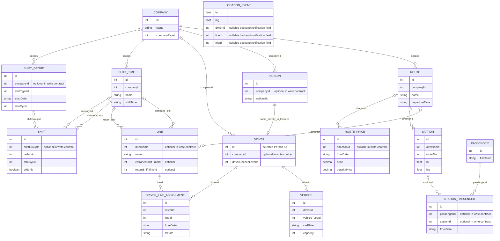
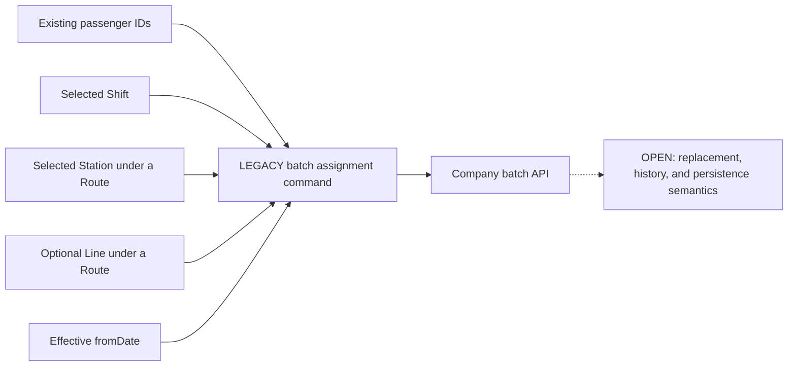
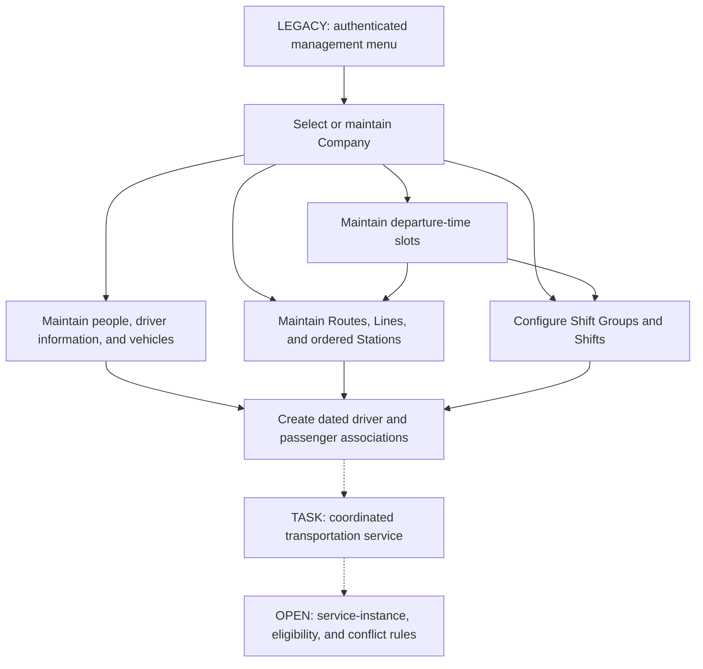
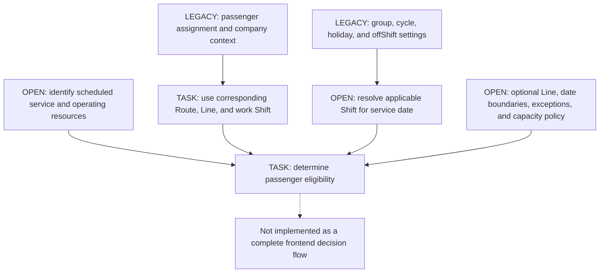

# Transportation Management System Business Domain

**Analysis date:** 2026-11-08  
**Target application:** `front/apps/panel`  
**Legacy business reference:** sibling `panel` frontend  
**Status:** source-based business analysis; not deployment or live-backend acceptance.

## Document Scope and Evidence

This document is the business reference for the transportation panel's future
development. It describes the requested operating model, the capabilities found
in the legacy application, and the much smaller implemented scope of the new app.
These three views must not be conflated.

| Marker          | Meaning                                                                                                                                         |
| --------------- | ----------------------------------------------------------------------------------------------------------------------------------------------- |
| **NEW**         | Present in the current `front/apps/panel` application or its shared libraries.                                                                  |
| **LEGACY**      | Wired behavior in the inspected sibling `panel` frontend. It has not necessarily been migrated or verified against a running backend.           |
| **CONTRACT**    | An interface, form payload, API wrapper, or read projection expresses a concept or relationship; backend enforcement is not established.        |
| **BACKEND**     | Narrowly inspected backend source corroborates notification contracts and recipient membership; this is not frontend behavior or live evidence. |
| **TASK**        | Explicitly required by the business description supplied for this analysis, whether implemented or not.                                         |
| **OPEN**        | Ambiguous, inconsistent, or not established by inspected evidence.                                                                              |
| **RECOMMENDED** | A proposed business safeguard or future capability requiring agreement; not an existing rule.                                                   |

An API wrapper or a visible input does not prove a complete workflow. A required
TypeScript property does not prove runtime validation. A menu or route guard does
not prove server authorization. "Implemented" in legacy observations means the
client contains the stated behavior, not that every endpoint or workflow succeeds.

Sources are identified as `[S01]` through `[S20]` in the evidence index at the end.
Paths there are relative to the enclosing TTab workspace, which contains `front`,
`panel`, and `transport-backend`. No source code, configuration, dependencies, or
other documentation was changed for this analysis.

## Contents

- [A. Business Overview](#a-business-overview)
- [B. Business Actors](#b-business-actors)
- [C. Core Business Entities](#c-core-business-entities)
- [D. Business Relationships](#d-business-relationships)
- [E. Business Workflows](#e-business-workflows)
- [F. Business Rules](#f-business-rules)
- [G. Functional Modules](#g-functional-modules)
- [H. Real-Time Tracking Business Flow](#h-real-time-tracking-business-flow)
- [I. Business Terminology](#i-business-terminology)
- [J. Open Questions and Missing Requirements](#j-open-questions-and-missing-requirements)
- [Source Evidence Index](#source-evidence-index)

## A. Business Overview

### Purpose and Objectives

**TASK:** The system is a multi-company Transportation Management System (TMS)
for administrators and transportation operators. Its purpose is to coordinate
people, vehicles, geographical service routes, work schedules, and transportation
assignments, then provide operational visibility through live location monitoring.

The intended business outcomes are:

- Maintain a consistent inventory of companies, people, drivers, and vehicles.
- Configure route coverage, lines, stops, departure times, and company schedules.
- Assign transportation resources and passengers to compatible services.
- Determine which service a passenger may use for the applicable work shift.
- Monitor active transportation and correlate movement with drivers and routes.
- Reduce fragmented scheduling, inconsistent assignments, and uncertainty about
  transportation availability across companies.

These are business objectives, not claims that all operational controls exist.
In particular, completed vehicle movement, service-instance planning, capacity
checks, and shift-based eligibility decisions were not found in the frontend.

### Current Delivery Boundary

**NEW:** The current panel is a reusable application foundation: authentication,
an authenticated workspace, shared layouts and form primitives, RTL/LTR support,
and runtime theme customization. Its business routes are login and workspace;
the workspace explicitly says company-management features will be migrated later.
There are no implemented transportation CRUD modules, map, or live-location
connection in this target app. Panel now uses an HttpOnly session-handle cookie
with server-held tokens; browser reloads preserve authentication, while the
default single-process server store signs users out on restart. `[S01, S02]`

**LEGACY:** The sibling Angular frontend contains company-scoped administrative
modules, people/driver/vehicle forms, route/line/station configuration, scheduling,
assignment flows, support requests, and partial map/notification integrations.
Those sources are the evidence for existing transportation concepts, not proof
that they are already available in the new panel. `[S03-S18]`

### Domain Contexts

The following are useful business boundaries, not assertions about existing
backend aggregate roots or transaction boundaries:

| Context                   | Responsibility                                                                              |
| ------------------------- | ------------------------------------------------------------------------------------------- |
| Organization and access   | Companies, selected company context, authenticated staff, and authorized operational scope. |
| People and fleet          | Person records, driver extensions, vehicles, types, and documents.                          |
| Transport network         | Routes, lines, geographical stations, ordering, and route pricing.                          |
| Workforce scheduling      | Named departure times, shift groups, shift types, rotation settings, and shifts.            |
| Transportation allocation | Dated driver-line associations and passenger shift/station/optional-line assignments.       |
| Operational monitoring    | Notification receipt and intended driver/vehicle location visualization.                    |
| Support                   | Driver/passenger support submissions and administrative viewing/deletion.                   |

Company context crosses these boundaries. Tenant context is an authentication
and notification concern; the code does not establish that a tenant equals a
company or that either has a one-to-one relationship with the other.

## B. Business Actors

| Actor or Persona                     | Evidence and Responsibilities                                                                                                                                                                             | Limits                                                                                                                                              |
| ------------------------------------ | --------------------------------------------------------------------------------------------------------------------------------------------------------------------------------------------------------- | --------------------------------------------------------------------------------------------------------------------------------------------------- |
| Administrator                        | **LEGACY:** The `Admin` role is recognized. It receives the broader management menu, including company and scheduling management. **TASK:** administrators configure and control transportation.          | The menu is not a verified permission matrix or evidence of company-wide/server-side authorization.                                                 |
| Manager                              | **LEGACY:** The `Manager` role is recognized; either Admin or Manager makes the frontend's `isManager` selection true. Company search is shown to this management persona.                                | Exact distinctions between Admin and Manager powers are not enforced by the inspected business route declarations.                                  |
| Transportation operator / dispatcher | **TASK:** operational staff coordinate transport. **LEGACY:** a smaller menu is internally called `opratorOptions`.                                                                                       | No `Operator` role claim is checked. The fallback menu must not be treated as a confirmed authorization role.                                       |
| Driver                               | **LEGACY/CONTRACT:** a managed person extension with licence/documents, vehicle associations, dated line assignments, and a support-applicant category.                                                   | Driver self-service, driver panel access, document approval, and the location-reporting client were not established by the administrative frontend. |
| Passenger                            | **LEGACY/CONTRACT:** a person-facing operational record selected for transport assignments and a support-applicant category. **TASK:** uses services corresponding to assigned route/line and work shift. | Passenger authentication, booking, check-in, attendance, and proof-of-boarding flows were not found in this panel.                                  |
| Authenticated panel user             | **NEW:** can sign in, enter the protected workspace, and log out through shared auth.                                                                                                                     | Being authenticated is not itself a transportation role or permission to read every company.                                                        |
| Location reporter                    | **OPEN:** some external client/device must supply locations for the requested monitoring capability; backend source accepts a location request.                                                           | Hardware, mobile application, capture frequency, accuracy, and consent are not inspected or proven.                                                 |
| Notification backend                 | **BACKEND:** accepts/authenticates hub connections and distributes typed support/location notifications to groups.                                                                                        | A technical integration actor, not an administrative human role. Recipient membership does not itself identify the company shown by the frontend.   |

The legacy `users` administrative form does not contain password or role
assignment. Creating a person there must not be documented as granting login
access. Authenticated identity IDs and business-person IDs also require explicit
mapping; they must not be assumed interchangeable. `[S02, S04, S06, S18-S20]`

## C. Core Business Entities

### C1. Company

**Responsibility:** represent an organization whose transport configuration and
operational records are being managed.

**LEGACY/CONTRACT:** Company fields include name, company type, city, address,
postal code, coordinates, mobile/phone/fax, description, and logo. Type options
are loaded from the backend, not a fixed frontend classification. Read models
also expose province/city display data and separate latitude/longitude. `[S05]`

Company scope is carried into route, scheduling, people, driver, and assignment
searches/forms. The selected company is shared mutable state; it is not reliably
derived from the URL on every operation. Tenant membership and company access
remain distinct concerns. Vehicle ownership is less explicit: vehicle searches
are company-filtered, but the vehicle write contract has no company field.

### C2. Person / Administrative User Record

**Responsibility:** hold personal identity and contact information used by
operational workflows.

**LEGACY/CONTRACT:** Fields include an ID, company reference, names, national ID,
mobile/phone/email, city/address/postal code, coordinates, and profile image.
The feature is named `users`; this does not make every record an administrative
login account. A birthday picker is visible but unbound and absent from the
write contract, so date of birth is not implemented data capture. `[S06]`

**OPEN:** whether a person is globally shared, company-owned, or associated with
multiple companies; how person identity relates to passenger identity and login
identity; and what deletion cascades are permitted.

### C3. Driver

**Responsibility:** represent a person qualified or intended to operate transport.

**LEGACY/CONTRACT:** The UI uses the selected person's ID as the driver ID and
loads person and driver details with that same ID. Driver-specific data includes
company, licence level, national-card images, driving-licence image, and smart-card
image. The form offers licence values 1 and 2, but does not explain their business
meaning or require document approval. `[S07]`

A driver can be referenced by vehicle records and by dated Driver-Line
Assignments. The inspected UI does not prove one vehicle per driver, exclusive
line assignments, or document-expiry/qualification rules.

### C4. Vehicle

**Responsibility:** represent a physical transportation resource and its recorded
driver association.

**LEGACY/CONTRACT:** The `car` feature uses a vehicle API. Its write model includes
driver, vehicle type, plate, color, production year, capacity, vehicle photograph,
smart-card image, insurance image, and vehicle-card image. The source spelling
`produnctionYear` is a wire-contract artifact, not preferred business terminology.
Vehicle-type creation collects `carTypeId` and `model`. `[S08]`

The vehicle stores a driver reference; Driver-Line Assignment stores no vehicle
reference. Consequently, driver-to-line assignment does not establish which
specific vehicle served a historical line/date. Capacity is captured metadata,
not a demonstrated allocation limit. Company derivation, association history,
maintenance status, and availability are unresolved.

### C5. Route: the Legacy Direction Entity

**Responsibility:** identify a company transport route and the ordered geographical
stops and service lines associated with it.

**LEGACY/CONTRACT:** `Direction` is the code/API name for the business Route. Its
write fields are company, name, and `departureTime`, labelled as departure from
the first station. Its detail navigation separately exposes Lines and Stations.
Its price and absence-penalty configuration also belongs to this entity. `[S09]`

There is no saved polyline, road geometry, geofence, or drawn-route field in this
frontend write contract. Station coordinates and ordering are the observed
geographical inputs. **TASK** requires defining routes on an interactive map;
that is not established as a completed legacy workflow.

### C6. Line

**Responsibility:** identify a named service variant associated with a Route.

**LEGACY/CONTRACT:** A Line references a Direction and may reference outbound
`entranceShiftTimeId` and return `returnShiftTimeId` clock slots. It is not a
Vehicle, a Shift, a live Trip, or an independently persisted road geometry.
The display field `enteranceShiftTimeName` is misspelled and typed numerically
in the legacy model. `[S10]`

The Direction selector is marked required in the template although `directionId`
is optional in the interface. The diagram's contract optionality must therefore
not be interpreted as approval for a Line without a Route.

Drivers are assigned to Lines over date ranges. Passenger batch assignment
allows an optional Line. The exact compatibility rule between a Line's clock
slots and a passenger's work Shift is not implemented in the inspected frontend.

### C7. Station

**Responsibility:** represent an ordered geographical stop of a Route.

**LEGACY/CONTRACT:** Station contains Direction, name, city/address, coordinates,
and `orderNo`; read models also expose province and separate latitude/longitude.
It references **Direction, not Line**. There is no line-specific stop-sequence
contract in the inspected client. `[S11]`

The form sorts existing stations and lets the user position an edited/new station,
then sends that station's new order number. It does not send a bulk reordered
sequence. Server resequencing, order uniqueness, and the handling of shared stops
or route variants require clarification.

### C8. Shift Time / Departure-Time Slot

**Responsibility:** represent a company-scoped named clock time for travel.

**LEGACY/CONTRACT:** Fields are company, name, and `shiftTime`. Lines and Shifts
refer to outbound/return Shift Time IDs. This entity is not a work Shift and is
also distinct from the Route's own first-station `departureTime`. The precedence
of those different time fields is unresolved. `[S12]`

### C9. Shift Group and Shift Type

**Responsibility:** configure a company's scheduling pattern and organize Shifts.

**LEGACY/CONTRACT:** A Shift Group has company, shift-type reference, name,
`startDate`, `rateCycle`, and Saturday/Thursday/Friday/public-holiday flags.
Shift types come from a backend lookup. Labels describe rotation configuration,
but no frontend enum identifies which values mean fixed or rotating. `[S12]`

**TASK** explicitly requires both fixed and rotating models. The current evidence
does not establish rotation units, calendar-generation rules, holiday execution,
or the meaning of every type value. Holiday flags initially being true is a form
default, not proof that every company is closed on those days.

### C10. Shift

**Responsibility:** represent a named schedule member within a Shift Group.

**LEGACY/CONTRACT:** A Shift has group, name, order, `rateCycle`, `offShift`, and
outbound/return Shift Time references. List models additionally expose start/end
display values. Passengers are assigned through `shiftId`. `[S12]`

When `offShift` is selected, the UI disables both travel-time selectors and removes
their IDs from the outgoing payload. This does not prove that the record is
globally inactive or define its calendar meaning. The precedence of cycle values
on both Shift and Shift Group remains open. Editing omits existing cycle/off-shift
values, so that behavior must not become intended scheduling policy.

### C11. Passenger

**Responsibility:** represent a person participating or being considered for
transportation allocation.

**LEGACY/CONTRACT:** Passenger search/list exposes identity/display information
and accepts `hasShift` and `hasStation` filters. The "add passenger" page selects
existing records for bulk assignment; it does not create a new personal identity.
The exact persistence mapping from Passenger ID to Person ID is not independently
established by this flow. `[S13]`

**TASK** requires association with the applicable route, line, and work shift.
The legacy batch payload instead uses Shift, Station, optional Line, and effective
start date. Route is indirectly reached through Station or Line, not sent as a
separate passenger-assignment Route ID. Partial assignments and multiple/current
assignment semantics require a business decision.

### C12. Transportation Assignment

**Responsibility:** coordinate operational resources and entitled passengers for
transportation. This is an umbrella business concept, **not one confirmed
persisted aggregate or a single implemented service-creation workflow**.

The inspected client expresses separate association types:

| Association or Command        | Captured Links                                                                         | Important Limit                                                                                     |
| ----------------------------- | -------------------------------------------------------------------------------------- | --------------------------------------------------------------------------------------------------- |
| Driver-Line Assignment        | Driver, Line, `fromDate`, `toDate`; read projections also show company/route metadata. | No vehicle, Shift, or explicit scheduled-service reference in the write model.                      |
| Batch passenger assignment    | `passengerIds`, `shiftId`, `stationId`, optional `lineId`, `fromDate`.                 | A multi-person command, not proof of one permanent assignment per passenger or one database entity. |
| Station-Passenger association | Passenger, Station, `fromDate`, association ID for edit/delete.                        | Relationship to the batch endpoint's persistence/history is not established.                        |

The task's coordinated service example is an intended end-to-end process, but the
frontend does not assemble all seven entities into one dated service instance.
Backend notifications contain Trip identifiers; that alone does not establish a
frontend Trip administration or dispatch workflow. `[S13-S15, S20]`

### C13. Route Price and Absence Penalties

**Responsibility:** configure an effective-dated amount and absence-penalty
parameters for a Route.

**LEGACY/CONTRACT:** Fields include Direction, `fromDate`, `price`, `penaltyPrice`,
and multipliers for absence with/without notice. There is no end date or currency
field in the inspected form. Multiplier controls are shown when the penalty
amount is positive. `[S09]`

The client does not demonstrate fare computation, billing, no-show recording,
effective-version selection, or penalty collection. Who pays, the notice cutoff,
the monetary unit, and whether amounts are per trip/person/day are unresolved.

### C14. Vehicle Location / Actual Driver Location Notification

**TASK:** Vehicle Location should describe a tracked vehicle's geographical state
and support updating its position along the assigned transportation route.

**LEGACY:** The actual incoming concept is `LocationNotification`, dispatched as
Driver Location state. The declared interface has Direction, Line, and nested
`Coordinate`; the mounted Leaflet subscriber reads flat `lat`/`lng`. `[S16, S17]`

**BACKEND:** The emitted object has flat latitude/longitude and nullable Trip,
Driver, Direction, Driver-Line, Line, and next-Station IDs. It has **no Vehicle ID,
company ID, timestamp, speed, heading, or sequence**. No frontend join resolves
that payload to the vehicle record. The administrative map is therefore not a
completed vehicle-tracking capability. See section H. `[S20]`

### C15. Support Request

**Responsibility:** record a driver/passenger support submission, not a ride
booking or a vehicle-dispatch order.

**LEGACY/CONTRACT:** The support record contains applicant type, person/contact
details, request date, subject, and description. Viewing and delete operations
are represented. A create wrapper exists but no completed panel submission UI
was found. Approval, reply, resolution, and status transitions are not implemented
by this administrative surface. `[S18]`

## D. Business Relationships

### Route, Line, and Station: Required Naming Distinction

| Concept             | Owns or References                                                                    | Must Not Be Assumed                                                                 |
| ------------------- | ------------------------------------------------------------------------------------- | ----------------------------------------------------------------------------------- |
| Route (`Direction`) | Company, first-station departure time, its Lines, ordered Stations, effective Prices. | An Angular URL, a vehicle, a live trip, or a saved road polyline.                   |
| Line                | A named Route variant with outbound/return Shift Time references.                     | Another name for Route, an independent stop sequence, or a driver/vehicle instance. |
| Station             | A stop with coordinates and order under a Route.                                      | A Line-owned stop or a verified nearest-stop allocation rule.                       |
| Shift               | Work-schedule member associated with a Shift Group and travel-time slots.             | A Line or a departure-time lookup.                                                  |

Route and Line are distinct records and workflows. The same Route can expose
multiple Lines and a separately maintained Station collection. Whether every
Line visits every Station, supports subsets, or differs only in schedule is
**OPEN**; the frontend has no line-to-station membership contract. `[S09-S12]`

### Source-Represented Entity Relationships

The following diagram describes frontend references, not database schema,
referential-integrity enforcement, exclusivity, or permitted concurrent records.
Optional markers reflect optional references in the available contracts. Company
scope expressed through search/read projections is not turned into an invented
relationship. Attributes are client identifiers and reference fields, not verified
database primary/foreign keys. Required DTO references likewise do not prove
runtime validity or backend enforcement.



The Location Event is intentionally unconnected to Vehicle: no vehicle identifier
or resolved vehicle association exists in this frontend path. Person-to-Passenger
mapping is intentionally not drawn as a proven identity relationship. Passenger
to Shift/optional Line is captured by the batch command below, not invented as a
confirmed persistent FK on the Passenger read model.



No source establishes overlapping-assignment legality, one current Line per
passenger, one vehicle per driver, or one driver per Line on a given date.

## E. Business Workflows

### E1. Company Transportation Configuration

**LEGACY:** A management persona searches/selects or creates a company, maintains
its details, and enters company-context modules. The shared selection supplies
company IDs to many forms and queries. Driver/vehicle, network, scheduling, and
allocation configuration are separate workflows rather than one atomic wizard.



**Limit:** A valid-looking `/client/:companyId` URL does not guarantee the current
company state matches that ID or that access was authorized. The legacy selection
guard returns true and does not resolve/verify a valid route company. `[S03-S05]`

### E2. Person, Driver, and Vehicle Registration

**LEGACY:** Maintain a personal record or search an existing person, then add
driver information using that person's ID. Register a vehicle by selecting a
driver and vehicle type, entering descriptive/plate/capacity data, and uploading
documents. Vehicle types may be created through an inline form. `[S06-S08]`

The driver wizard's second-step gate checks whether national ID is defined, not
a complete approved-driver state. Existing driver details are not fully patched
into the form; document previews are not equivalent to hydrated upload values.
There is no confirmed approval, licence-expiry, insurance-expiry, maintenance,
driver-availability, or vehicle-readiness workflow.

**OPEN:** null/empty images on edit may mean preserve, clear, or invalid input;
that behavior must be verified rather than inferred from preview rendering.

### E3. Route, Line, Station, and Price Configuration

**LEGACY:** Create/update a company Route with its first-station departure time.
A second step captures Route price and absence-penalty settings once a Route ID
exists. Within Route detail, maintain Lines and Stations separately. Lines select
outbound/return Shift Time references; Stations capture geography and ordering.

The direction map can load company/Route station lists. However, coordinate-click
output and live marker mutation are commented, and route-control initialization
is inconsistent. The task's map-drawn Route creation is not a confirmed working
legacy flow. There is no persisted Line-specific geometry. `[S09-S11, S17]`

### E4. Driver and Vehicle Assignment

**LEGACY:** Select a Route, load its Lines, select a driver, set start/end dates,
and save a Driver-Line Assignment. Separately, vehicle registration records its
driver association. The assignment form does not select Vehicle or Shift.

**TASK:** Transportation services must coordinate driver, vehicle, route/line,
company, and applicable operational schedule. This cannot be described as one
already-implemented assignment aggregate. Vehicle choice for an assignment,
historical resource consistency, availability, overlap, and substitution policy
remain undefined. `[S08, S14]`

### E5. Shift Configuration

**LEGACY:** Maintain named departure-time slots; create a company Shift Group
with backend-supplied type, start date, cycle, and holiday flags; then maintain
its Shifts, order, cycle/off-shift setting, and outbound/return slot references.
An off-shift submission omits both travel-time IDs. `[S12]`

**TASK:** Both fixed and rotating schedules must be supported. The frontend does
not implement the date-to-shift resolution needed to decide a passenger's actual
working/transport day. Rotation interval units, type meanings, holiday treatment,
group-versus-shift cycle precedence, and midnight/timezone behavior remain open.

### E6. Passenger Registration and Transportation Assignment

Personal identity creation belongs to the person form. **LEGACY** "add passenger"
selects existing records for assignment; it is not proof of a separate passenger
registration transaction. `[S06, S13]`

The batch workflow searches by company and assignment flags, selects passengers,
chooses a Shift, selects a Route to load Stations and Lines, then chooses Station,
optional Line, and effective date. Only passenger selection is explicitly required
in this form. Assigned and add modes send different `hasShift`/`hasStation` values;
their interpretation for partially assigned people is not established.

A separate Station-Passenger workflow lists and changes individual station
associations. Its add flow contains a hardcoded company ID, its edit flow restores
only association ID/date, and its payload handling is inconsistent with its model.
Those are defects, not legitimate scoping or assignment policy. `[S13, S15]`

### E7. Passenger Eligibility for a Scheduled Service

**TASK:** A passenger is expected to use transport corresponding to the assigned
Route, Line, and applicable work Shift. Company-specific schedules must be taken
into account. This requirement is not an implemented frontend eligibility engine.

Potential decision inputs exist in separate places: passenger Shift/Station/Line
assignment, assignment start date, Station-to-Route membership, Line-to-Route and
travel-time references, Shift Group configuration, dated driver assignments, and
vehicle metadata. The client does not join these into a decision for a dated Trip
or scheduled service.



This diagram identifies requirements/dependencies, not an approved algorithm.
Do not infer that selecting a passenger, showing a list row, receiving a location
notification, or having `hasShift=true` grants boarding eligibility. There is no
implemented boarding/check-in enforcement in the inspected panel.

### E8. Real-Time Vehicle Monitoring

**LEGACY:** Starting the authenticated layout attempts a SignalR connection and
dispatches location notifications into state. A separate Route map subscribes to
that state; its marker method does nothing because the body is commented out.
The default dashboard instead renders a fixed-data map demo. `[S16, S17]`

**TASK:** Actual vehicle markers, dynamic movement, and driver/route correlation
are required. They remain incomplete; section H documents exactly where the
existing pipeline stops.

## F. Business Rules

### F1. Confirmed Frontend Behavior and Contract Constraints

These are deliberately narrower than a complete business policy or backend rule.

| ID  | Classification  | Observed Rule or Behavior                                                                                                                                                                                                      |
| --- | --------------- | ------------------------------------------------------------------------------------------------------------------------------------------------------------------------------------------------------------------------------ |
| L01 | LEGACY          | Shared current-company state supplies scope to many operational forms and lists; it is mutable and may differ from a route ID.                                                                                                 |
| L02 | LEGACY/CONTRACT | Driver extension operations use the selected Person ID as Driver ID.                                                                                                                                                           |
| L03 | CONTRACT        | Vehicle writes reference a Driver; Driver-Line writes reference Driver and Line, with from/to dates, but no Vehicle or Shift.                                                                                                  |
| L04 | CONTRACT        | A Line references a Route; a Station references a Route, not a Line.                                                                                                                                                           |
| L05 | LEGACY          | Enabling `offShift` disables travel-time selectors and removes their IDs from the Shift submission.                                                                                                                            |
| L06 | LEGACY          | Batch passenger assignment explicitly requires selected passenger IDs; Line is visibly optional, and Shift/Station/date lack equivalent required validators in that form.                                                      |
| L07 | CONTRACT        | Route pricing is effective from a date and belongs to Direction, not to Line; no end date/currency is captured by that form.                                                                                                   |
| L08 | LEGACY          | Penalty multipliers are displayed when penalty amount is positive. HTML bounds are 0..5 with notice and 1..5 without notice; separate numeric validation also exists. These inputs do not prove executed penalty calculations. |
| L09 | LEGACY          | Company form requires coordinates and validates postal/mobile formats, but does not explicitly require every identity/classification field.                                                                                    |
| L10 | LEGACY          | Person form requires and validates mobile number. National ID/postal code have length constraints when populated; a checksum or mandatory national ID is not demonstrated.                                                     |
| L11 | LEGACY          | Vehicle plate is required and constrained to eight characters. Capacity/year and positive driver/type selection are not equivalently validated.                                                                                |
| L12 | LEGACY          | Driver licence choices are 1 and 2; document approval/required-document policy is not implemented in the form.                                                                                                                 |
| L13 | LEGACY          | Admin or Manager selects the management menu. Other authenticated users receive fallback menu logic; this does not verify an Operator role or resource permissions.                                                            |
| L14 | LEGACY          | Station order editing sends one Station with an order number; global resequencing is not demonstrated. Required accepts initial zero, with no inspected positive-order rule.                                                   |

Evidence: `[S03-S15]`. Weak or inconsistent validation is a discrepancy to resolve,
not a recommendation to preserve the same weak policy.

### F2. Explicit Task Requirements

| ID  | Required Business Capability                                                                                               | Existing Evidence Boundary                                                                                                              |
| --- | -------------------------------------------------------------------------------------------------------------------------- | --------------------------------------------------------------------------------------------------------------------------------------- |
| T01 | Support multiple companies with company-specific transport configuration.                                                  | Legacy scopes many operations by company, but isolation and access validation are not established; new app has no company workflow yet. |
| T02 | Register/manage drivers and vehicles and coordinate their route/line/schedule assignments.                                 | Legacy records and partial associations exist, not a complete dated service/resource assignment.                                        |
| T03 | Define geographical routes interactively and distinguish Routes from Lines.                                                | Distinct Route/Line/Station models exist; map drawing/rendering is incomplete.                                                          |
| T04 | Support fixed and rotating company schedules.                                                                              | Parameters/type lookup exist; exact models and date resolution are not established.                                                     |
| T05 | Associate passengers with Route, Line, and applicable Shift and use the corresponding service.                             | Legacy uses Station/Shift/optional-Line batch assignment; eligibility and optional-Line semantics are unresolved.                       |
| T06 | Receive live positions through WebSocket communication and dynamically show vehicle movement correlated with driver/route. | SignalR over WebSockets receives data; completed marker updates, vehicle join, and fleet monitoring are absent.                         |

### F3. Assumptions That Must Not Become Confirmed Rules

- A tenant equals a company, or selecting a company authorizes access to it.
- Every person is an authenticated account; Passenger ID necessarily equals Person ID.
- One driver has one vehicle, or a Driver-Line record permanently identifies a vehicle.
- Every Line has its own geometry/stations, or every Line necessarily visits every Route Station.
- A passenger has exactly one current assignment, or a new start date closes earlier records.
- An omitted passenger Line means automatic, nearest, first, or any Line allocation.
- Shift cycle values are measured in days, holidays are skipped, or off-shift means a specific calendar outcome.
- Assignment date bounds are inclusive, non-overlapping, or in a known timezone.
- Vehicle capacity is enforced, a visible driver is qualified/available, or document previews mean approval.
- A support request is a booking, or a location event proves a passenger may board.

### F4. Recommended Rules Requiring Product/Backend Agreement

| ID  | Recommendation, Not Implemented Policy                                                                                                                |
| --- | ----------------------------------------------------------------------------------------------------------------------------------------------------- |
| R01 | Authorize selected company and entity ownership server-side; make route/company context consistent and clear sensitive state on changes.              |
| R02 | Define a dated service/Trip/resource identity before joining shifts, driver, vehicle, route/line, and passengers into eligibility.                    |
| R03 | Specify valid date ranges, overlap/exclusivity rules, substitutions, cancellations, and assignment-history preservation.                              |
| R04 | Define vehicle capacity, operational readiness, driver licence/document validity, and over-allocation policies before enforcing them.                 |
| R05 | Validate same-company Route/Line/Station/Shift relationships and decide what optional or partial assignment means.                                    |
| R06 | Validate coordinates, stop ordering, calendar conversions, numeric units, money units, and effective-price selection consistently with backend rules. |
| R07 | Establish authorized telemetry subscriptions, stable tracking identity, freshness/ordering, reconnect behavior, privacy, and retention.               |
| R08 | Decide deletion/audit policy for people, drivers, passengers, assignments, prices, and support records, especially where history must survive.        |

## G. Functional Modules

### Architecture Relevant to Business Behavior

**NEW:** The Nx application composes reusable standalone zoneless Angular
libraries. Signal Forms hold local drafts; NgRx Signal Stores handle auth/theme;
shared layouts have no transport state. There are no completed transport stores,
map consumers, or realtime services in this target app. `[S01, S02]`

**LEGACY:** Lazy NgModule features are organized around business pages and shared
forms, APIs, facades, reducers, and effects. Most entity state is globally registered;
support/UI state also uses component-store patterns. This affects observable
behavior: some "already Loaded" checks ignore changing company/filter/page scope.
A cached list must not be treated as proof of current assignment or eligibility.
The generic API wrapper uses response envelopes and CRUD service methods; UI
submit/update labels do not guarantee a particular HTTP verb. `[S03, S18, S19]`

| Module                       | Legacy Functionality                                                                     | Route / Interaction and Current Limit                                                                                         |
| ---------------------------- | ---------------------------------------------------------------------------------------- | ----------------------------------------------------------------------------------------------------------------------------- |
| Authentication               | Token-based sign-in, session/user claims, logout, and email recovery UI.                 | New app has reusable login/logout/guards; transport-specific role/company policy is not mounted.                              |
| Companies                    | Search/list/create/edit/delete, type and geography/logo data, current-company selection. | Legacy `/companys` and `/client/:companyId`; context guard does not establish route/access consistency.                       |
| People (`users`)             | Identity/contact/address/photo management.                                               | Legacy company context; birthday field is disconnected and shared people search may omit company scope.                       |
| Drivers                      | Person-selection/registration step and driver-information/documents step.                | Legacy `/client/:companyId/drivers`; incomplete detail hydration and weak second-step gating.                                 |
| Vehicles (`cars`)            | Vehicle/driver/type/plate/capacity/documents and inline type creation.                   | Legacy `/client/:companyId/cars`; ownership, image-preservation, and capacity enforcement unresolved.                         |
| Departure times              | Company named travel-time slots.                                                         | Legacy `/client/:companyId/shift-time`; referenced by Lines and Shifts.                                                       |
| Scheduling                   | Shift Groups/types/rotation settings and Shifts.                                         | Legacy `/client/:companyId/shift`; cycle/off-shift edit omissions and dormant drag ordering.                                  |
| Routes and pricing           | Company Directions, nested Lines/Stations, effective price/penalties.                    | Legacy `/client/:companyId/direction`; `detail/:directionId` separates Lines/Stations; price hydration omits existing amount. |
| Driver-Line allocation       | Dated association search/list/create/edit/delete.                                        | Legacy `/client/:companyId/driver-line`; no direct Vehicle/Shift assignment or overlap checks.                                |
| Passengers                   | Existing-record search/selection and batch Shift/Station/optional-Line allocation.       | Legacy `/client/:companyId/passenger`; add mode is assignment, not identity creation.                                         |
| Station-Passenger allocation | Station-specific individual association CRUD surface.                                    | Nested station navigation; hardcoded scope and incomplete edit state make it unreliable.                                      |
| Support                      | Search/details/delete surface and notification inputs.                                   | Legacy `/dashboard/request` is routed though navigation is limited; detail navigation is defective, not a booking workflow.   |
| Dashboard/map                | Default Mapbox map with sample markers/line; separate company Route map uses Leaflet.    | No completed fleet marker updates; summary/report widgets and alternative maps are dormant or static.                         |
| Runtime appearance           | Not a transport business capability.                                                     | New app's working shared customization helps presentation; it must not be mistaken for business-module completion.            |

### Important Incomplete Behavior

- Company URL and shared selected-company state can disagree; some searches omit scope.
- Line search overwrites paging input with a fixed first-page request shape.
- Passenger/station-passenger caching can skip new filter/page/station requests.
- Passenger removal dispatches person/user removal rather than passenger removal.
- Station-Passenger add loads with hardcoded company 22; edit does not hydrate all references.
- Driver edit does not restore all licence/document controls; Shift edit omits cycle/off-shift values.
- Existing Route price edit omits the price; price-detail ID semantics are ambiguous.
- Penalty fields are optional in the write interface, but the form's numeric
  validator rejects null; omitted versus zero penalties need an agreed policy.
- Company/person coordinate picking and Route-map routing have incomplete/broken code.

These are findings about source behavior, not intentional business rules or a
request to fix code during this documentation task.

## H. Real-Time Tracking Business Flow

### H1. Actual Connection and Notification Path

**LEGACY:** Entering the authenticated layout calls `SignalRService.startConnection()`.
It builds a Microsoft SignalR connection to `/notifications`, obtains a bearer
token from legacy stored auth, sets `skipNegotiation: true`, and forces WebSockets.
It awaits connection start and only then registers the event handler. There is no
raw application `new WebSocket()` protocol or configured transport fallback. `[S16]`

The handler receives a type-name key and payload through `notificationFromServer`,
removes the notification namespace, and switches by short type. Support events
feed support/UI subjects; Location events directly dispatch Driver Location into
the globally registered Direction state. The location reducer replaces **one
latest-location object**, not a map of a fleet's latest positions.

The mounted Leaflet component subscribes to that state, reads top-level `lat`
and `lng`, and calls `currentLocationDriver()`. That method's marker creation and
`setLatLng` update code is entirely commented out. Thus **no incoming event creates
or moves a vehicle marker in this implementation**. `[S16, S17]`

```mermaid
sequenceDiagram
    participant Layout as Legacy authenticated layout
    participant Client as SignalR service
    participant Hub as Notification hub
    participant Producer as Backend routing service
    participant State as Global Direction location state
    participant Map as Mounted Leaflet Route map

    Layout->>Client: startConnection()
    Client->>Hub: Start SignalR with token over forced WebSockets
    Note over Client,Hub: skipNegotiation=true; no fallback configured
    Hub-->>Client: Connection established
    Client->>Client: Register notificationFromServer handler
    Producer->>Hub: Location notification to Admin and Trip groups
    Hub-->>Client: Type name plus flat payload
    Client->>State: Set Driver Location
    State->>State: Replace single latest location
    opt Company Route map is mounted
        State-->>Map: Location emission
        Map->>Map: Read flat latitude and longitude
        Map->>Map: currentLocationDriver()
        Note over Map: Marker mutation is commented out; rendering stops here
    end
```

Backend participant behavior in this diagram is separately corroborated source,
not a captured live exchange. The system supplying the original coordinate
request was not inspected. `[S20]`

### H2. The Two Active Map Paths Are Different

| Map Surface                                               | Existing Behavior                                                                                               | What It Does Not Establish                                                                                                                                   |
| --------------------------------------------------------- | --------------------------------------------------------------------------------------------------------------- | ------------------------------------------------------------------------------------------------------------------------------------------------------------ |
| Default `/dashboard` Mapbox component                     | Hardcoded center, two draggable sample markers, fixed GeoJSON line, navigation/directions/geolocation controls. | No SignalR/location-state subscription; browser geolocation follows the panel user's browser, not a vehicle.                                                 |
| `/client/:companyId/direction/show-map` Leaflet component | Loads company Directions/Stations; selected Route filters stations; subscribes to Driver Location state.        | Marker update is a stub; route rendering refers to an unassigned routing-control member; waypoint order/rendering is not a verified complete route workflow. |
| Dormant/alternative components                            | Commented dashboard summary, static route grid, Google-map alternative, and logged routing-provider responses.  | Not a completed analytics, tracking, or road-drawing capability.                                                                                             |

Mapbox, Leaflet/routing controls, Neshan integration fragments, and commented
Google Maps alternatives coexist. The intended production map/routing provider
must be decided instead of inferring a single authoritative implementation.

### H3. Location Contract and Identity Gap

**LEGACY declaration:** Direction ID, Line ID, and capitalized nested `Coordinate`.
**LEGACY consumption:** flat `lat`/`lng` through an untyped callback.
**BACKEND producer:** copies nested request coordinates into flat notification
latitude/longitude and includes nullable correlation identifiers. `[S16, S20]`

Expected JSON using the inspected backend's standard serialization defaults:

```json
{
  "tripId": null,
  "driverId": null,
  "directionId": null,
  "driverLineId": null,
  "lineId": null,
  "nextStationId": null,
  "lat": 0,
  "lng": 0
}
```

This is a shape illustration, not actual coordinates, a live capture, or a valid
business movement event. Zero coordinates are not intrinsically invalid. The
declaration and consumer need reconciliation before relying on typed correlation.
No Vehicle/company ID or timestamp can be assumed to exist in this payload.

### H4. Recipient Scope and Reliability

**BACKEND:** The inspected hub is authenticated and has tenant, Admin, and cached
Trip membership behavior. The location sender targets `GroupAdmin` and
`GroupTrip-{TripId}`; no company-specific location group was established in this
path. The panel sends no explicit company/Trip join request when selection changes.
Frontend event-method capitalization differs from the backend constant, but
SignalR client method matching is case-insensitive; that alone is not the failure.
`[S20]`

Selecting a company or showing a manager menu does not prove authorization or
subscription to that company's vehicles. In particular, the UI's Admin-or-Manager
management persona must not be equated with backend Admin-group membership.

**LEGACY limits:** no configured automatic reconnect, idempotent start, event
unregistration, stop-on-logout, company filtering, initial position snapshot,
per-vehicle keyed state, message ordering, or freshness policy. The Leaflet store
subscription has teardown, but that is not hub lifecycle management. `[S16, S17]`

### H5. Proposed Complete Monitoring Flow

**RECOMMENDED, not implemented:** authenticate and subscribe to an explicitly
authorized operational scope; normalize/validate each event; identify the service,
driver, and vehicle using an agreed stable key; maintain scoped latest positions;
create/update markers and route context; show stale/disconnected state; restore
subscriptions/snapshots after reconnect; clear sensitive state on logout/context
change. Add interpolation or route matching only after product requirements define
accuracy and movement expectations.

## I. Business Terminology

| Term                       | Consistent Meaning                                                                                                                         |
| -------------------------- | ------------------------------------------------------------------------------------------------------------------------------------------ |
| Company                    | Organization whose operational transport context is selected; code/API spelling includes `companys`.                                       |
| Tenant                     | Authentication/notification isolation context; not proven equivalent to Company.                                                           |
| Person                     | Identity/contact record managed by the `users` feature; not automatically a login account.                                                 |
| Authenticated identity     | Login/security identity and claims; explicit mapping to business Person IDs is required.                                                   |
| Driver                     | Person extension with licence/documents and operational associations.                                                                      |
| Vehicle                    | Physical fleet resource; legacy feature calls it Car, API calls it vehicle.                                                                |
| Vehicle Type               | Backend-selected model/type; `carTypeId` and `vehicleTypeId` have different uses.                                                          |
| Route                      | Business `Direction`: company route with first-station departure time, Lines, Stations, and Prices.                                        |
| Line                       | Named service variant under a Route, with possible outbound/return travel-time slots.                                                      |
| Station                    | Geographical ordered stop under a Route, not directly under a Line.                                                                        |
| Shift Time                 | Named travel/departure clock slot; not a work Shift.                                                                                       |
| Shift Group                | Company schedule configuration grouping Shifts, type/cycle/start/holiday parameters.                                                       |
| Shift Type                 | Backend lookup value; fixed/rotating mapping is not established in the frontend.                                                           |
| Shift                      | Work-schedule member with group/order/cycle and possible travel-time references.                                                           |
| offShift                   | Flag that suppresses outbound/return IDs in the UI; calendar/operational meaning requires clarification.                                   |
| Driver-Line Assignment     | Dated Driver-to-Line association; not an explicit vehicle assignment.                                                                      |
| Passenger                  | Transport participant/projection selected for assignment; identity mapping requires confirmation.                                          |
| Passenger Batch Assignment | Command assigning common Shift/Station/optional-Line/start-date values to selected passenger IDs.                                          |
| Station-Passenger          | Individually managed dated Passenger-to-Station association.                                                                               |
| Transportation Assignment  | Umbrella coordination concept, represented by several partial associations rather than one established aggregate.                          |
| Scheduled Service / Trip   | Intended dated operational execution; Trip IDs occur in backend notifications, but no complete frontend planning lifecycle is established. |
| Eligibility                | Permission/expectation to use the service corresponding to assignments and applicable Shift; not merely list membership.                   |
| Route Price                | Effective-dated Route amount; currency, unit, version selection, and payer are unresolved.                                                 |
| Vehicle Location           | Requested fleet position concept; currently received as an unjoined driver/location notification.                                          |
| Support Request            | Driver/passenger support ticket, not ride booking or dispatch authorization.                                                               |
| UI direction               | RTL/LTR presentation; unrelated to the transport entity named Direction.                                                                   |

## J. Open Questions and Missing Requirements

### J1. Organization, Identity, and Authorization

| ID  | Question / Missing Requirement                                                                   | Why It Matters                                                                         |
| --- | ------------------------------------------------------------------------------------------------ | -------------------------------------------------------------------------------------- |
| Q01 | How do tenant, company, authenticated identity, Person, Driver, and Passenger identities relate? | Scope, joins, permission checks, and deletion cannot safely assume equivalence.        |
| Q02 | Can people/drivers belong to multiple companies, and how is a vehicle's company derived?         | Write contracts and read/search scope differ.                                          |
| Q03 | What are actual actor permissions and permitted company memberships?                             | Menu personas and the current selection guard do not enforce a complete access policy. |
| Q04 | What should happen on direct company URLs, scope switches, and inaccessible/deleted companies?   | Existing mutable context can disagree with requested scope or cached records.          |
| Q05 | What are retention, audit, soft-delete, and cascade rules for person/driver/passenger history?   | Passenger removal currently dispatches user removal; the business impact is unclear.   |

### J2. Fleet, Network, and Service Identity

| ID  | Question / Missing Requirement                                                                               | Why It Matters                                                                         |
| --- | ------------------------------------------------------------------------------------------------------------ | -------------------------------------------------------------------------------------- |
| Q06 | What uniquely identifies a dated transportation service or Trip and its lifecycle?                           | Current associations do not bind all resources and passenger eligibility together.     |
| Q07 | Is a vehicle assigned explicitly per service/driver-line/date, and how are substitutions/history recorded?   | Current vehicle-driver link alone cannot reconstruct a historical operating vehicle.   |
| Q08 | Are capacity, plate uniqueness, vehicle readiness, licence level, and document validity enforced; by whom?   | Current forms do not establish these operational constraints.                          |
| Q09 | Does a Line share every Route Station, choose a subset, or have a distinct order/geometry?                   | No Line-to-Station membership exists in the inspected frontend contracts.              |
| Q10 | Which map/routing provider is authoritative, and what route geometry must be saved?                          | Demo, incomplete Leaflet, routing fragments, and alternatives currently coexist.       |
| Q11 | Are station coordinates/city required, may routes cross regions, and how is ordering/resequencing validated? | Frontend validations are incomplete and no geographic eligibility boundary is defined. |

### J3. Scheduling and Passenger Eligibility

| ID  | Question / Missing Requirement                                                                                               | Why It Matters                                                                                    |
| --- | ---------------------------------------------------------------------------------------------------------------------------- | ------------------------------------------------------------------------------------------------- |
| Q12 | Which shift-type values mean fixed and rotating, and what units/precedence do cycle fields have?                             | Parameters exist but do not define an executable calendar.                                        |
| Q13 | How do holidays, off-shift entries, night shifts, timezone, and Jalali/Gregorian conversion affect service dates?            | Date-to-shift and travel eligibility cannot be determined reliably.                               |
| Q14 | How do Route departure time, Line time slots, Shift time slots, and list start/end values interact?                          | Multiple time representations exist without a precedence rule.                                    |
| Q15 | Are assignment dates inclusive; are overlaps permitted; does a new assignment replace or close earlier ones?                 | Historical/current eligibility and resource conflicts depend on these rules.                      |
| Q16 | Is passenger Line mandatory as described in the task, or optional as in the legacy UI? If optional, what does omission mean? | This is a direct requirement/source discrepancy, not a safe implementation default.               |
| Q17 | How are partially assigned passengers searched and repaired?                                                                 | Existing add/list modes send paired assignment flags without an established partial-state policy. |
| Q18 | How do bulk company assignment and Station-Passenger CRUD reconcile; what IDs and history do they update?                    | They appear to overlap but their persistence relationship is unknown.                             |
| Q19 | What exceptions, booking/check-in, attendance, cancellations, or one-way/return eligibility are required?                    | The task's usage expectation has no complete execution/enforcement workflow.                      |

### J4. Pricing, Monitoring, and Support

| ID  | Question / Missing Requirement                                                                                                 | Why It Matters                                                                             |
| --- | ------------------------------------------------------------------------------------------------------------------------------ | ------------------------------------------------------------------------------------------ |
| Q20 | What currency/unit/payer applies to Route price and absence penalties; how are effective versions and notice cutoffs resolved? | Captured values are not a completed pricing/penalty policy.                                |
| Q21 | Does `directionprices/{id}` identify Route or Price, and how should existing price edits load?                                 | Current effect/form behavior is ambiguous and omits the price value.                       |
| Q22 | Which screen owns live monitoring and which entity keys each marker: Driver, Vehicle, Driver-Line, or Trip?                    | The default dashboard is a demo and the payload has no Vehicle ID.                         |
| Q23 | Which users may subscribe to company-wide locations, and how are tenant/company/Trip groups authorized?                        | Current Admin/Trip recipient behavior is not company selection or Manager authorization.   |
| Q24 | What event timestamp, sequence, accuracy, stale timeout, initial snapshot, reconnect, and history guarantees are needed?       | Existing payload and client cannot establish current fleet freshness or ordered movement.  |
| Q25 | What system supplies driver positions, at what frequency, with what privacy/consent and retention requirements?                | The administrative frontend does not establish capture provenance or permitted monitoring. |
| Q26 | Who creates support requests, and what response/resolution lifecycle is actually required?                                     | Legacy panel shows details/delete but not an approved support or booking workflow.         |

### J5. Analysis Boundaries

No production endpoints, credentials, map keys, or personal data are reproduced
here. No live services were called, and no runtime/business enforcement was
verified through execution. Backend inspection was limited to notification
payload/recipient corroboration. Resolve the open questions with product owners
and authoritative backend contracts before promoting them into requirements or
implementing eligibility, dispatch, or tracking behavior.

## Source Evidence Index

Paths below are relative to the enclosing TTab workspace, not this document's
directory. They identify the primary inspected evidence and should be revisited
when the implementation changes.

| ID  | Primary Sources                                                                                                                                                                                                                                                                                                                                                                              | Evidence                                                                                                                |
| --- | -------------------------------------------------------------------------------------------------------------------------------------------------------------------------------------------------------------------------------------------------------------------------------------------------------------------------------------------------------------------------------------------- | ----------------------------------------------------------------------------------------------------------------------- |
| S01 | `front/apps/panel/src/app/app.routes.ts`; `workspace.page.ts`; `app.config.ts`; `app.routes.server.ts` in the same app directory                                                                                                                                                                                                                                                             | Current target has auth/workspace composition and no transport feature routes.                                          |
| S02 | `front/libs/shared/auth/data-access/src/lib/auth.config.ts`, `session.store.ts`, `auth.guards.ts`; `front/libs/shared/auth/feature/src/lib/`; `front/libs/shared/theme/`; `front/apps/panel/ARCHITECTURE.md`                                                                                                                                                                                 | New auth/state/presentation foundation and explicit migration boundary.                                                 |
| S03 | `panel/src/app/shell/shell.routes.ts`; `panel/src/app/shell/config/root-reducers.ts`; `panel/src/app/shell/ui/layout/layout.component.ts`                                                                                                                                                                                                                                                    | Legacy feature routes, global state, selected company, and startup behavior.                                            |
| S04 | `panel/src/app/shared/data-access/enums/role.enum.ts`; `panel/src/app/auth/data-access/store/auth.selectors.ts`; `panel/src/app/shell/ui/custom-sidebar/custom-sidebar.component.ts`; `panel/src/app/auth/data-access/guards/is-authenticated.guard.ts`                                                                                                                                      | Admin/Manager versus fallback operator persona and navigation checks.                                                   |
| S05 | `panel/src/app/pages/company/data-access/models/set-company.model.ts`; `panel/src/app/pages/company/data-access/api/company.service.ts`; `panel/src/app/pages/company/ui/company-form/company-form.component.ts`; `panel/src/app/pages/company/data-access/gurds/is-company-selected.guard.ts`; `panel/src/app/shared/ui/company-search/company-search.component.ts`                         | Company data, API spelling, validation, mutable selection, incomplete route guard.                                      |
| S06 | `panel/src/app/pages/users/data-access/models/set-user.model.ts`; `panel/src/app/pages/users/data-access/api/users.service.ts`; `panel/src/app/pages/users/ui/user-form/user-form.component.ts` and `.html`; `panel/src/app/shared/ui/people-search/people-search.component.ts`                                                                                                              | Person identity/contact creation, birthday omission, and search scope.                                                  |
| S07 | `panel/src/app/pages/drivers/data-access/models/set-driver.model.ts`; `panel/src/app/pages/drivers/feature/add-driver/add-driver.component.ts` and `.html`; `panel/src/app/pages/drivers/ui/driver-form/driver-form.component.ts` and `.html`                                                                                                                                                | Person/driver identity, two-step registration, document/licence fields and edit behavior.                               |
| S08 | `panel/src/app/pages/car/data-access/models/set-car.model.ts`, `car.model.ts`, `car-type.ts`; `panel/src/app/pages/car/data-access/api/car.service.ts`; `panel/src/app/pages/car/ui/car-form/car-form.component.ts` and `.html`                                                                                                                                                              | Vehicle-driver relationship, company read/search scope, type/documents/capacity and validation.                         |
| S09 | `panel/src/app/pages/direction/data-access/models/set-direction.ts`, `direction.model.ts`, `set-direction-price.model.ts`; `panel/src/app/pages/direction/ui/direction-form/direction-form.component.html`; `panel/src/app/pages/direction/ui/direction-price/direction-price.component.ts` and `.html`; `panel/src/app/pages/direction/data-access/store/direction-effects.ts`              | Route identity/departure, effective pricing, penalties and edit gaps.                                                   |
| S10 | `panel/src/app/pages/line/data-access/models/line.model.ts`; `panel/src/app/pages/line/ui/line-form/line-form.component.ts` and `.html`; `panel/src/app/pages/line/data-access/api/line.service.ts`                                                                                                                                                                                          | Distinct Lines, time slots, Route reference, paging issue.                                                              |
| S11 | `panel/src/app/pages/station/data-access/models/set-station.model.ts`, `station.model.ts`, `station-detail.model.ts`; `panel/src/app/pages/station/ui/station-form/station-form.component.ts`                                                                                                                                                                                                | Station belongs to Direction, geography, ordering and one-record save.                                                  |
| S12 | `panel/src/app/pages/shift-time/data-access/models/shift-times.model.ts`; `panel/src/app/pages/shift/data-access/models/set-shift-group.model.ts`, `set-shift.model.ts`, `shift.model.ts`, `shift-detail.model.ts`; `panel/src/app/pages/shift/ui/add-shift-group/`; `panel/src/app/pages/shift/ui/shift-form/`; `panel/src/app/pages/shift/data-access/api/shift.service.ts`                | Distinct scheduling entities, type lookup, holidays/cycle/off-shift behavior and edit gaps.                             |
| S13 | `panel/src/app/pages/passenger/data-access/models/get-passenger.ts`, `set-shif-station.ts`; `panel/src/app/pages/passenger/feature/set-passenger/set-passenger.component.ts`; `panel/src/app/pages/passenger/ui/passenger-option/`; `panel/src/app/pages/passenger/data-access/store/passenger-effects.ts`                                                                                   | Batch allocation, optional Line, filter modes, incorrect removal and caching.                                           |
| S14 | `panel/src/app/pages/driver-line/data-access/models/set-driver-line.model.ts`, `driver-line.model.ts`, `driver-line-detail.model.ts`; `panel/src/app/pages/driver-line/ui/driver-line-form/driver-line-form.component.ts` and `.html`                                                                                                                                                        | Dated Driver-Line relationships and absence of Vehicle/Shift references.                                                |
| S15 | `panel/src/app/pages/station-passenger/data-access/models/set-station-passenger.ts`; `panel/src/app/pages/station-passenger/ui/station-passenger-form/station-passenger-form.component.ts`; `panel/src/app/pages/station-passenger/feature/add-station-passenger/add-station-passenger.component.ts`; `panel/src/app/pages/station-passenger/data-access/store/station-passenger-effects.ts` | Individual association, hardcoded company, incomplete edit and cache scope.                                             |
| S16 | `panel/src/app/shared/data-access/services/signal-r.service.ts`; `panel/src/app/shared/data-access/models/driver-location.model.ts`; `panel/src/app/pages/direction/data-access/store/direction-actions.ts`, `direction-reducer.ts`, `direction-facade.ts`                                                                                                                                   | SignalR event dispatch, stale location type, and single latest-location state.                                          |
| S17 | `panel/src/app/map/map.component.ts`; `panel/src/app/pages/dashboard/dashboard.component.html`; `panel/src/app/pages/direction/feature/direction-map/`; `panel/src/app/pages/direction/feature/directions-shell/directions-shell-routing.module.ts`; `panel/src/app/shared/components/leaflet/leaflet.component.ts`                                                                          | Active demo versus routed Leaflet, incomplete markers, geography and route-control initialization.                      |
| S18 | `panel/src/app/pages/requests/data-access/models/request.model.ts`; `panel/src/app/pages/requests/data-access/api/request.service.ts`; `panel/src/app/pages/requests/data-access/store/request.store.ts`; `panel/src/app/pages/requests/ui/request-form/`; `panel/src/app/pages/dashboard/dashboard-routing.module.ts`                                                                       | Support, not booking; actual routed surface and incomplete actions.                                                     |
| S19 | `panel/src/app/shared/data-access/services/api.service.ts`; `panel/src/app/shared/interfaces/picture-request.ts`; `panel/src/app/shared/utils/validators/`; `panel/src/app/shared/ui/date-picker/date-picker.component.ts`                                                                                                                                                                   | Response/CRUD patterns, images, local validators and date conversion boundaries.                                        |
| S20 | `transport-backend/src/Core/Shared/Notifications/LocationNotification.cs`; `transport-backend/src/Core/Application/Routing/CreateDriverLocationRequest.cs`; `transport-backend/src/Infrastructure/Routing/RoutingService.cs`; `transport-backend/src/Infrastructure/Notifications/NotificationHub.cs`, `NotificationSender.cs`, `Startup.cs`                                                 | Backend-only corroboration: flattened location fields, event method/arguments, recipient membership and expiry closure. |
